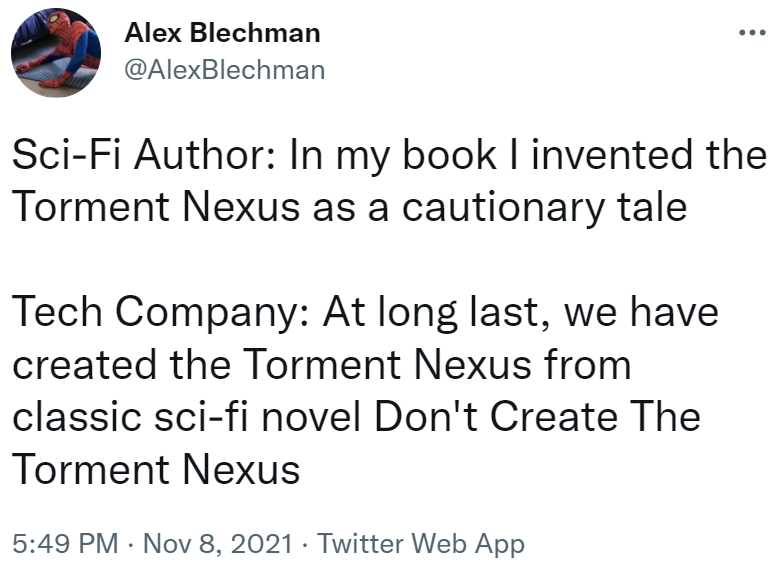

+++
title = 'Cyberpunk was a warning, not a guide'
date = 2026-07-12T16:06:08+02:00
draft = false
tags = ['privacy', 'philosophy', 'cyberpunk']
categories = ['blog']
image = "IMG_6282.jpg"
transparentimg = "zucc.png"
summary = "How Cyberpunk Literature created the Aeasthetic Hyperstition that haunts our society."
+++

## The end of the Silicon Valley golden age

Wake up, choom. The golden age of silicon valley sell-outs is coming to an end. The promise of upward social mobility is being replaced with talk of a [permanent underclass](https://en.wiktionary.org/wiki/permanent_underclass). The playbook was simple: found a startup, scale it, and cash out. Multimillion-dollar exit packages that bought them generational wealth and the option to live in luxury without ever lifting a finger again.

And many of them used this chance - Bill Gates got filthy rich, diversified his investments, and now claims to engage in Philanthropy. Tom Anderson of MySpace wealth vanished into golf and boutique landscape photography. Get rich, cash out. But some founders were built different.

People like Elon Musk and Mark Zuckerberg built businesses so big, they could have retired a thousand times over. Yet they stay, at the helm of their companies, managing them for better or worse. They choose to live a stressful life, in the eye of the public, criticized and at risk of losing everything, when they could have bought film cameras to photograph trees and beaches for the rest of their lives. Why would you do that to yourself? I suggest, by looking at the way they run their companies, you can see why: They are nerds, obsessed by the technology of science fiction, obsessively trying to bring it to life.

Mark Zuckerberg dreams of the Metaverse. He got bitten by Snow Crash and Neuromancer. He has incinerated more than 80 billion USD via his Meta Reality Labs division, building nothing profitable, all for the sake of a nebulous vision he extracted from his favourite books and movies.

Elon Musk dreams of self-driving cars, AI, and an interplanetary humanity. He clearly doesn't think about product-market fit a lot: just listen to him speak about space. It's good that he found a way to make Tesla and SpaceX temporarily financially sustainable, but he is clearly not mainly motivated by wealth. He wants to be involved in a manned mission to Mars, and if that requires crazy amounts of money, he'll figure out where to get that. Inspired by Isaac Asimov's *Foundation* and Iain M. Banks' *Culture* series, he aims to create interplanetary transport and benevolent AI to help humanity.

## Aesthetic Hyperstition

But these projects are not based in reality. They are haunted by **Aesthetic Hyperstition**.

[Hyperstition](https://en.wikipedia.org/wiki/Hyperstition) is a term for ideas or narratives that can shape reality to make themselves real, coined by the Cybernetic Cultural Research Unit. Fiction that engineers its own existence from the future. The aesthetic of Science Fiction and Cyberpunk is like crack to nerds, which is why they try to bring the coolest concepts into reality. William Gibson wrote fiction so compelling, they are trying to make it a reality, no matter the cost.

An Aesthetic Hyperstition is a fictional aesthetic so potent, it makes itself real through [memetic](https://en.wikipedia.org/wiki/Memetics) infection.

An idea so powerful, our culture created a memetic antibody: **[The Torment Nexus](https://x.com/AlexBlechman/status/1457842724128833538)**.

## Missing the message

The cruel irony that haunts both Elon and Mark is that they gush about these books, but seemingly haven't *read* them. *I, Robot*, while on the surface being about AI alignment, is really about the fact that an engineer cannot rationally overcome the messy world of humans, language, and ethics. A fact that Elon seemingly completely missed.

They read *Snow Crash* and missed that the Metaverse was a corporate-controlled escape from a corporate-ruined world. They read *Culture* and missed that it was a anarcho-socialist utopia. They read *Neuromancer* and saw a pitch deck, not a warning.

Most ironic of all, the word *grok* is getting poisoned by xAI - in *Stranger in a Strange Land*, it means to understand, fully, with intuition, and with empathy and love. In Elon land, it means an edgy chatbot with center-right political leanings and loose safeguards.

Try reading these books through the lens that human nature is an engineering problem you need to pull apart, optimize and debug. These technocapitalists suffer from Protagonist syndrome, thinking they are a rational actor who can build the torment nexus and control it. They wouldn't fly too close to the sun. And so the incredible writing of these works seduced them, while the deeper message about human nature got lost.

Elon and Mark are not alone - Sam Altman, Peter Thiel and many other nouveau ultra-rich poorly copy the style, without grokking the substance.

Even if their visions weren't fundamentally flawed, the corrupting forces of capital are turning them from bad to worse. Zuckerberg trying to save his empire from being platform-dependent on hardware manufacturers, afraid of Apple's power over him, desperately looking for an out. Elon believes in the incredible power of artificial intelligence, so once he lost control of OpenAI he founded xAI to also have skin in this game - No matter the cost, even if it means weakening safeguards and rushing ahead. The need for the power of AI was greater than his regard for AI safety, even after advocating for over ten years.

## Bottom-up computational resistance

Their course seems set: A downward spiral towards a technocapital singularity. And us cowboys are left watching, seemingly powerless.

On a structural level, we are. The tech elite is rubbing shoulders with governments around the world, outspending and out-lobbying any democratic effort we could muster. But you *can* have an impact on a local and cultural level, to liberate your immediate environment and to build a foundation for a move away from their iron grip.

Remember, computers are just machines. Do not let them control you. Their power relies on network effects and user trust. They have clearly proven unworthy of this power - Now we need trailblazers to set the tone of discourse around our relationship with technology. Away from a passive, consumerist relationship to a proactive, self-controlled one. A new technological culture to usher in a new post-technocapitalist era.

The goal should be a bottom-up cultural rebellion: Meta is powerless if you don't use their platform and block their trackers. If you store your photos on your own server, Google doesn't get any of your data. And by normalizing jailbreaking, you make big companies think twice about shipping more anti-features to your devices, lest they lose control of another customers' device.

You can root your phone, block their ads. Install Linux on any hardware you can get your hands on. Only buy tech that is fixable, flashable, and usable without its vendor. Rice your laptop so heavily that it becomes hostile architecture to anyone but you. Advance the culture towards ownership and control of your compute, decentralized away from big tech. This starves their apparatus of fuel and spreads alternative perspectives on technology and compute.

By normalizing studying and customizing our tech, we make the machine work for us, instead of the other way around. This is slow but steady work, creating alternatives and local solutions for when a need arises. Our current compute infrastructure is centralized and built to benefit the technocapital elite first, users second. We need to work on shifting this balance towards a more personal, democratic and decentralized compute environment. Perhaps then more of us get to devote themselves to the noble duty of landscape photography.

**Stay vigilant, and happy hacking.**

---

